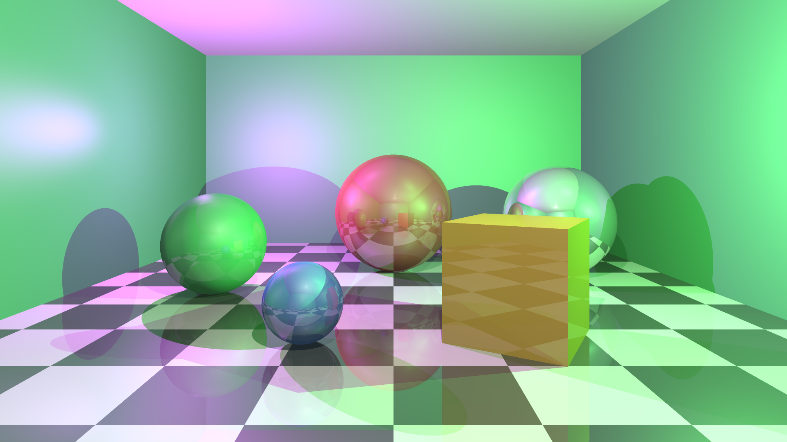
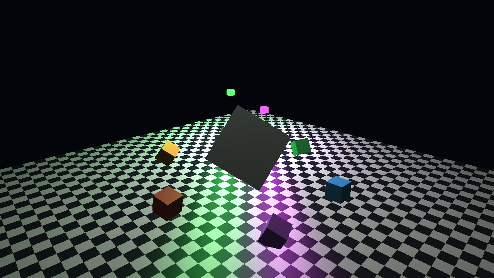

# fasm experiments

Small programs written in x86-64 assembly for [fasm](https://flatassembler.net/),
targeting Linux. Most of them use raw syscalls and no libc.

| Program | What it is | Size |
|---|---|---|
| `hello.asm` | Hello, World | 232 B |
| `mandel.asm` | Interactive Mandelbrot explorer in the terminal | 2.8 KB |
| `ray.asm` | Multithreaded raytracer that writes a PPM and a PNG | 3.9 KB |
| `gl.asm` | OpenGL demo: lit cubes, coloured lights, mouse interaction | 25 KB |

## Build

Needs `fasm` and `ld`. `gl` also needs libGL and libX11, plus a display
(WSLg works).

```sh
make            # build everything
make mandel && ./mandel
make ray    && ./ray
make gl     && ./gl
```

The Makefile passes `-m 131072` to fasm, because the 1080p raytracer's buffers
are bigger than fasm's default 16 MB heap. Building `ray.asm` with plain
`fasm ray.asm` fails with "out of memory".

## `ray` - raytracer to PPM to PNG



A 1920x1080 render of a closed room with green walls, a checkered floor, four
spheres (one a mirror) and a cube turned 30 degrees. Three point lights (a dim
white one, a purple one and a green one) cast coloured, overlapping shadows.
Shading is Blinn-Phong with up to five reflection bounces and 2x2
supersampling.

- **Vectors:** each 3-vector is one `xmm` register (x, y, z, 0), and SSE4.1
  `dpps` does the dot products.
- **Threads:** one `clone()` thread per CPU, with no libc. Threads claim rows
  from a shared counter using `lock xadd`, so load stays balanced.
- **Output:** it writes `out.ppm` and then `out.png`. The PNG encoder is built
  in: CRC32, Adler-32 and uncompressed ("stored") deflate blocks. That's why
  the PNG is about as big as the PPM, 6 MB each.
- **Speed:** about 1.8 s on one CPU and 0.64 s on 22 CPUs of a hybrid laptop
  chip. The speedup is limited by the hardware, not the scheduling.

## `gl` - OpenGL demo



A spinning cube and a ring of six small cubes on a checkered floor, lit by a
purple light and a green light orbiting in opposite directions, plus a dim
white one. It uses fixed-function OpenGL through GLX, with 4x MSAA when
available. This is the one program that links against shared libraries
(libX11, libGL, libm, libc) instead of using raw syscalls.

| Input | Action |
|---|---|
| Drag a cube | Slide it over the floor; it lifts while held and settles when dropped |
| Drag empty space | Orbit the camera |
| Scroll wheel | Zoom |
| `r` | Reset cubes and camera |
| `Esc` / `q` / close window | Quit |

Cubes are picked by casting a ray from the mouse and testing it against a
bounding sphere around each cube.

`./gl --shot` renders 40 frames, saves `shot.ppm` and exits (the screenshot
above came from this). `./gl --shot x1 y1 x2 y2` first injects a left-button
press at (x1,y1), a drag to (x2,y2) and a release, which is handy for testing
without a mouse. Under WSLg the renderer is Mesa's `llvmpipe` (software).

## `mandel` - terminal Mandelbrot explorer

Each text cell is an upper-half-block character with the foreground set to the
top pixel and the background to the bottom pixel, so every cell shows two
square-ish pixels in 256 colours. The maths is scalar SSE2 doubles.

| Key | Action |
|---|---|
| `w a s d` / arrows | Pan |
| `+` / `-` | Zoom in / out |
| `i` / `k` | More / fewer iterations |
| `r` | Reset |
| `q` / Ctrl-C | Quit |

Zooming re-centres on the boundary of the set. Each pixel is scored by how
sharply the iteration counts change around it, and the view moves to a
high-scoring pixel near the middle of the screen. Zoom is capped at level 85,
where double precision runs out.

## Notes

- `.backup/` holds earlier versions of some programs (made before risky
  changes), with their binaries or renders alongside.
- `shot.png` is the `--shot` frame at a fixed moment (t = 6.3 s); the large
  cube happens to face away from the lights in it. A live run varies.
